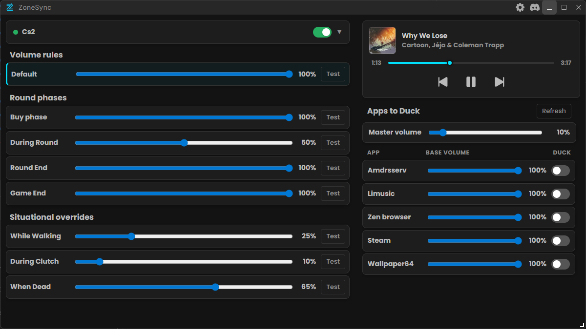

# ZoneSync

**A dynamic music volume controller for competetive 5v5 games.**

## Overview
I built **ZoneSync** because I love listening to music while playing competetive 5v5 games, but I constantly missed critical audio cues like enemy footsteps. Alt-tabbing to lower the volume or manually pausing tracks was distracting and often got me killed.
I built **ZoneSync** because I love listening to music while playing competitive 5v5 games, but I constantly missed critical audio cues like enemy footsteps. Alt-tabbing to lower the volume or manually pausing tracks was distracting and often got me killed.

**ZoneSync** solves this by automatically adjusting the volume of your background apps (Spotify, Discord, Opera, etc.) based on real-time game events.

## Features (with clickable videos)
## Features
- **Dynamic Volume Control:** Automatically ducks volume during important gameplay moments.
- **Context-Aware:**
  - **Walking:** Lowers volume when you hold your Walk key (e.g., Shift).
    
  - **Clutch Mode:** Automatically lowers volume when you are the **last player alive** (1vX situations).
  - **Death Mode:** Restores volume when you die.
  - **Round & Buy Phase:** Custom volume levels for active combat vs. shopping time.
    
- **Testing:** test the volume of each situation to fine tune before a match.
- **App Mixer:** choose exactly which apps you want to control (e.g., mute Spotify but keep Discord normal).
  
  
  Note: all funcions use the same logic, just for different events

  Note: all functions use the same logic, just for different events

## Supported games
**Counter-Strike 2** is supported today. More titles are on the way.

## How to use
ZoneSync uses the **Overwolf Game Events Provider (GEP)** to detect game states locally on your machine.

1. **Install** the app via the Overwolf Store.
1. **Install** the app from the [Overwolf Store](https://www.overwolf.com/app/progzerek-zonesync).
2. **Launch a supported game.**
3. **Configure** your preferred volume levels for each game state.
4. **Play!** The app runs quietly in the background.

## Download

ZoneSync is available for download on the **Overwolf App Store**.
[Download ZoneSync on Overwolf](https://www.overwolf.com/app/progzerek-zonesync)

## Feedback & Support
Found a bug or have a feature request?
Contact: zonesync.help@gmail.com

[Join the Discord community](https://discord.gg/YxYEffWc4Q) or email zonesync.help@gmail.com
